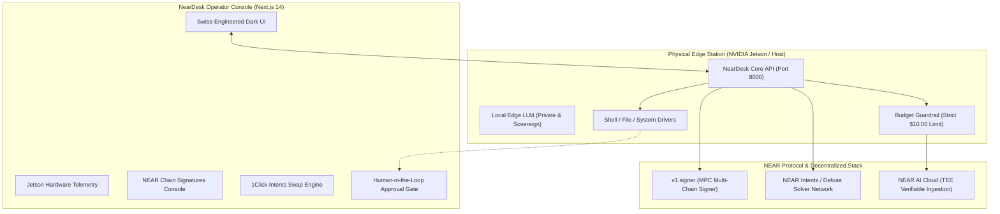

# NearDesk 🟢

> **The Sovereign Edge AI Operator Desk for NEAR Protocol**  
> *Hardware-anchored agents, decentralized MPC Chain Signatures, 1Click cross-chain intents, and verifiable confidential AI.*

---

## 🚀 Overview

**NearDesk** is an edge-native operator station designed to run directly on physical hardware (such as the **NVIDIA Jetson Orin / Nano**) or in a containerized edge environment.

By fusing **local private compute** on physical edge nodes with **NEAR Protocol's Chain Abstraction stack**, NearDesk delivers true **User-Owned AI**:
- **Sovereign Local Execution:** Shell commands, hardware diagnostics, and sensitive data processing stay strictly private on the Jetson edge node.
- **NEAR Chain Signatures (MPC):** A single NEAR account controls and signs transactions natively for **Bitcoin, Ethereum, Solana, and Base** without cross-chain bridges or exposed private keys.
- **NEAR Intents (1Click Cross-Chain Swaps):** The agent autonomously sources quotes and initiates swaps via the Defuse solver network.
- **Confidential Computing (TEE):** Cloud reasoning requests routed to NEAR AI Cloud (`cloud-api.near.ai`) run inside hardware-verified Intel TDX and NVIDIA Confidential Computing enclaves.
- **Human-in-the-Loop Approval Gates:** No shell commands, file modifications, or financial signatures can be executed without physical operator authorization in the UI.
- **Strict Budget Ceiling:** Hard-enforced financial guardrails (metered down to the fraction of a cent) to prevent runaway cloud inference costs.

---

## 🏆 NEAR Hackathon Tracks

NearDesk is built to compete at the intersection of three core tracks:

| Track | Why NearDesk is Built for This |
|---|---|
| **Privacy & Private AI** | Edge-first deployment on NVIDIA Jetson. Private data and terminal commands never touch the public internet. Cloud inference utilizes verifiable TEE hardware attestation. |
| **AI Security & Defense** | Strict Approval Gates and FunctionCall key fences ensure the agent cannot execute destructive shell actions or drain wallets without operator consent. |
| **Agent Economy & Unstoppable DeFi** | The agent holds its own multi-chain balances via NEAR Chain Signatures (BTC/ETH/SOL) and participates in the 1Click Defuse solver market. |

---

## 🏛️ System Architecture



---

## ⚡ Quickstart

### 1. Prerequisites
- **Node.js:** v18+ (Node 20 or 22 recommended)
- **Python:** 3.10+
- *(Optional)* **Docker:** for the Jetson board emulator

### 2. Configure Secrets
Copy the template and fill in your API key:
```bash
cp secrets.env.example secrets.env
```

Edit `secrets.env`:
```env
NEARAI_API_KEY=sk-...
NEARAI_BASE_URL=https://cloud-api.near.ai/v1
NEAR_MAX_BUDGET_USD=10.00
NEAR_NETWORK=testnet
NEAR_ACCOUNT_ID=your-account.testnet
```

### 3. Start NearDesk API (Backend)
```bash
cd apps/api
pip install -r requirements.txt
uvicorn app.main:app --reload --host 0.0.0.0 --port 8000
```
API docs available at: `http://localhost:8000/docs`

### 4. Start NearDesk Web Console (Frontend)
```bash
cd apps/web
npm install
npm run dev
```
Open [http://localhost:3000](http://localhost:3000) to access the operator console.

### 5. (Optional) Run the Jetson Board Emulator
Simulate a physical Jetson Orin board inside Docker:
```bash
npm run emu:up
```

---

## 🛠️ Built With

- **AI Ingestion:** [NEAR AI Cloud](https://cloud.near.ai) (OpenAI-compatible TEE endpoints).
- **Multi-Chain Execution:** [NEAR Chain Signatures](https://near.org) (`v1.signer-prod.testnet`).
- **Cross-Chain Settlement:** [NEAR Intents & Defuse](https://near-intents.org).
- **Backend:** FastAPI, Python 3.11, Pydantic, HTTPX.
- **Frontend:** Next.js 14, Tailwind CSS, Lucide Icons (Swiss dark industrial aesthetic).
- **Edge Deployment:** NVIDIA Jetson Linux (L4T / Tegra), Docker Compose.

---

## 🔒 Security & Guardrails

- **Zero Unsigned Operations:** All foreign transactions are signed through decentralized MPC nodes.
- **Physical Approval Gates:** High-risk actions (executing shell scripts or broadcasting cross-chain swaps) generate interactive tickets that require manual confirmation.
- **Budget Lock:** Cloud calls are instantly frozen once the $10 budget threshold is reached, falling back to 100% local edge processing.
