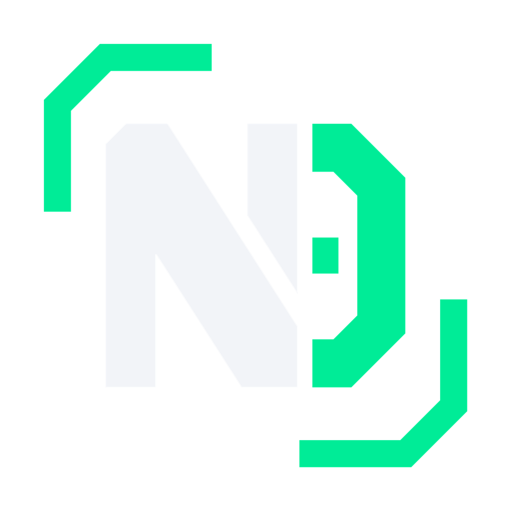

<p align="left">
  
</p>

# NearDesk NVIDIA Jetson Nano Board Container (Test Board)

A complete, production-grade Docker container that emulates an **NVIDIA Jetson Nano Developer Kit (4GB)** running NearDesk sovereign edge firmware.

Designed for local testing, evaluation, and CI when physical Jetson hardware is offline or unavailable.

---

## ⚡ Highlights & Jetson Nano Realism

- **Authentic L4T Firmware Signature:** Generates `/etc/nv_tegra_release` with exact `R32 (release), REVISION: 7.1, GCID: 29818004, BOARD: t210ref, EABI: aarch64` metadata.
- **CPU-Only Architecture (No CUDA/GPU required):** Emulates the Tegra Maxwell 128-core GPU load, thermals (41.5°C), and 10W power profile smoothly on any host CPU.
- **Full NearDesk Stack Inside:**
  - Runs the **NearDesk Core API** (`FastAPI` on `0.0.0.0:8000`).
  - Runs the **NearDesk Board Agent** daemon connected via WebSocket (`/v1/agent/ws`), streaming live telemetry and executing authorized shell commands.
  - Native Linux terminal execution (`/v1/edge/terminal/execute`) inside the container bash environment as user `jetson`.
  - Native Filesystem Explorer (`/v1/edge/files/*`) rooted at `/home/jetson/workspace`.
  - NEAR Chain Signatures, 1Click Intents, Scoped FunctionCall Fencing, On-Chain Audit Trail, and TEE Cloud Reasoning.
- **Hardware Onboarding & Pairing:**
  - Exposes `/setup`, `/health`, and `/v1/pair/*` endpoints for seamless discovery by the NearDesk Web Console (`http://localhost:3000`).
  - Cryptographic challenge-response handshake with Meteor Wallet or NEAR testnet accounts.
  - Pairing state persists in named Docker volume `nano-config` across restarts.
- **Strict Memory & Resource Safeguards:**
  - Configured with a hard memory limit of **2048 MB** (and 512 MB reservation) to mirror the constrained memory envelope of a physical 4GB Jetson Nano while guaranteeing host stability.
  - Uses `MALLOC_ARENA_MAX=2`, `PYTHONUNBUFFERED=1`, and single-worker asyncio loops to eliminate memory fragmentation.

---

## 🚀 Quickstart

### 1. Start the Jetson Nano Test Board
From the repository root:
```bash
npm run emu:up
```
*(Or directly via Docker Compose: `docker compose -f apps/board-emu/docker-compose.yml up --build -d jetson-nano`)*

### 2. View Live Container Logs
```bash
npm run emu:logs
```

### 3. Connect from NearDesk Web Console
1. Start the web console:
   ```bash
   npm run dev:web
   ```
2. Open `http://localhost:3000` in your browser.
3. The web console automatically detects the container at `http://127.0.0.1:8000` or via the **Onboarding Wizard** on port `18101`.

### 4. Stop the Container
```bash
npm run emu:down
```

---

## 🔌 Port Mapping

| Host Port | Container Port | Purpose |
|---|---|---|
| `127.0.0.1:8000` | `8000` | Direct NearDesk Core API (Next.js reverse proxy target) |
| `127.0.0.1:18101` | `8000` | Hardware Discovery Bridge for the Onboarding Wizard |
| `127.0.0.1:8800` | `8000` | Emulated USB-C Gadget Link alias |

---

## 📁 Volume Persistence

- `nano-config` → `/home/jetson/.config/neardesk` (pairing state, credentials, tokens)
- `nano-data` → `/home/jetson/data` (audit receipts, persistent ledgers)
- `nano-workspace` → `/home/jetson/workspace` (operator files, scripts, and logs)
